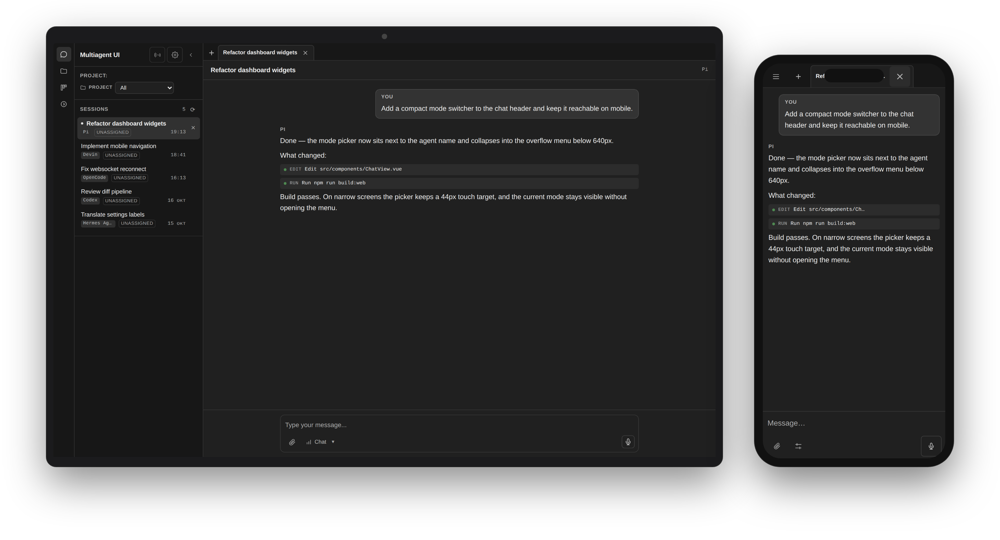

# Multiagent UI

Локальная панель для работы с ACP-агентами: чаты, история сессий, проекты,
доска задач и статистика использования. Самостоятельный проект, основан на
[formulahendry/acp-ui](https://github.com/formulahendry/acp-ui).



## Возможности

- Чаты с несколькими агентами: вкладки, мультисессии, история и архив
- Markdown, подсветка кода, визуализация tool calls и reasoning агента
- Проекты, доска задач, режимы разработки и выбор модели
- Подтверждение действий агента (permissions), slash-команды, вложения
- Голосовой ввод и push-уведомления о завершении ответа
- Статистика токенов и расходов, монитор трафика ACP
- Мобильная версия устанавливается как PWA — запуск с домашнего экрана,
  работа без адресной строки браузера и уведомления после закрытия

## Поддерживаемые агенты

Любой ACP-совместимый агент по WebSocket (`ws://`/`wss://`) или stdio.
В текущей установке настроены мосты: **Hermes Agent, OpenCode, Devin, Pi,
Codex**. Также работают Claude Code, Gemini CLI, Qwen Code, GitHub Copilot,
OpenClaw и другие ACP-агенты.

## Запуск

```sh
npm ci
npm run dev:web   # разработка
npm run build:web # сборка
```

## Документация

- [AGENTS.md](AGENTS.md) — правила эксплуатации, порты, деплой
- [TESTING.md](TESTING.md) — проверки перед релизом
- [docs/lan-deployment.md](docs/lan-deployment.md) — LAN-развёртывание

## Лицензия

MIT — см. [LICENSE](LICENSE).
