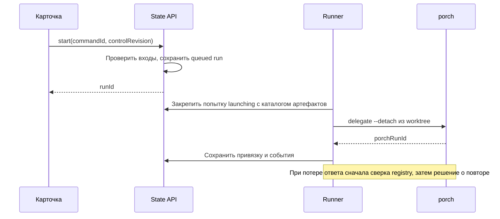

# Первая поставка: ядро выполнения из карточки

Дата: 2026-09-30. Это план разработки; описанные возможности ещё не реализованы. Основание — [согласованный общий план](agent-execution-plan.md). Следующие поставки — [roadmap](agent-roadmap.md).

## Goal Capsule

Из карточки запустить solo-выполнение принятых требований и плана через Devin, Codex или Pi, получить проверенный результат в отдельной ветке, остановить и восстановить работу без потери истории. Использовать существующий porch, процессы в Compose-раннере и git worktree. Слияние и публикация остаются отдельными действиями.

Выполнять U1–U7 по зависимостям. U1 проверяет фактическую работоспособность porch внутри раннера до подключения производственных запусков. Подготовка идеи и три групповых режима описаны отдельно; они используют контракты этого ядра.

## Product Contract

### Requirements

- **R1. Карточка — задача.** В карточке находятся документы, согласования, текущее состояние выполнения, ветка, связанное обсуждение и история запусков. Существующие колонки доски сохраняются. Закрытие браузера не останавливает выполнение.
- **R2. Принятые входы.** Требования и план имеют неизменяемые версии и отдельное явное согласование. Дизайн необязателен. План содержит критерии и способ проверки; запуск связывает конкретные версии документов, настройки участников и исходный коммит.
- **R3. Solo и составы.** Пользователь сохраняет и редактирует состав: реализатор, reviewer и checker, каждый с явно выбранными CLI и моделью. Solo означает один реализатор; проверяющие роли запускаются последовательно. В первой поставке доступны Devin, Codex и Pi. Несовместимые настройки отклоняются до запуска.
- **R4. Работа с кодом.** Реализатор изменяет отдельный worktree и ветку задачи. Проверки выполняются в отдельной копии результата. Итог — ветка, изменения и отчёт для приёмки, без автоматического merge или push.
- **R5. Управление.** Повторная команда не запускает дубликат. Остановка сохраняет изменения. Изменение требований останавливает выдачу работы и активные попытки, аннулирует согласование плана; продолжение возможно новым запуском после согласования входов.
- **R6. Проверенная готовность.** Успешный выход агента сам по себе не завершает задачу. Требуются проверки, reviewer/checker-гейт и приёмка пользователя. Неустранённые блокирующие замечания и исчерпание лимитов видны пользователю.
- **R7. Восстановление и история.** Сохраняются попытки, события, результаты и причины остановки. Перезапуск раннера не создаёт вторую живую попытку. Продолжение после прерывания получает документы, прошлые результаты и открытые замечания.
- **R8. Совместимость.** Старые карточки, claims и внешние прогоны porch продолжают работать. Новый механизм включается явно для выбранной карточки. При недоступном сервере управляющие действия недоступны; офлайн-кеш не отправляет их позже автоматически.

### Key Decisions

- **KD1 — первая поставка solo** (session-settled: user-approved). Governs R3, R6. Далее Fusion → оркестратор → Swarm; подготовка идеи — отдельная фича.
- **KD2 — требования и план принимаются отдельно** (session-settled: user-approved). Governs R2, R5. Генерацию этих документов не включать в ядро.
- **KD3 — состояние принадлежит карточке** (session-settled: user-directed). Governs R1, R7. История нескольких запусков входит в задачу; текущий запуск не заменяет саму карточку.

## Planning Contract

### Key Technical Decisions

- **KTD1 — переиспользовать porch** (session-settled: user-approved — вместо трёх новых адаптеров: существующие адаптеры уже различают протоколы CLI). Covers R3, R7. Обёртка acp-ui обращается к CLI porch; `--prompt-file` передаётся porch, а не предполагается флагом Devin/Codex/Pi.
- **KTD2 — процессы и worktree в v1** (session-settled: user-directed — вместо контейнера для каждого участника: сократить первый этап). Covers R4. Сервисы продолжают работать через Compose. Отдельный интерфейс среды выполнения позволит добавить контейнеры позднее; worktree не является ограничением доступа к файловой системе.
- **KTD3 — сервер управляет переходами карточки.** Covers R1, R5, R8. Текущее выполнение — часть карточки в доменной модели и UI. Хранить его в серверном агрегате, связанном с ID карточки, и собирать представление карточки с ним. Старый браузерный PUT всей доски не может перезаписать выполнение, согласования или удалить управляемую карточку.
- **KTD4 — state-сервер принимает команды, раннер выполняет их.** Covers R5, R7. Запуск, наблюдение и отмена porch происходят в одной среде раннера и под одним UID. State-сервер не управляет PID из другого контейнера.
- **KTD5 — неизменяемые снимки и новые сессии при продолжении.** Covers R2, R7. Документы, состав и критерии фиксируются в запуске. Подключение к живому supervisor восстанавливает наблюдение; новая попытка получает контекст из артефактов. Не обещать одинаковый native resume для всех CLI.
- **KTD6 — сериализованные изменения и восстановимые проекции.** Covers R5, R8. В единственном процессе state-сервера общая очередь сериализует compare-and-write для доски, claims и исполнения. Агрегат выполнения — источник истины; board/claims — восстанавливаемые проекции. Новый механизм не использует принудительный PUT без ревизии после конфликта.
- **KTD7 — явная проверка результата.** Covers R6. Зафиксировать правила существующего review-гейта и лимиты в запуске. Отсутствующее или повреждённое доказательство блокирует приёмку; не переносить в новый путь legacy-поведение, допускающее готовность при отсутствии файлов проверки.

### High-Level Technical Design

Схемы задают связи и переходы; точные имена модулей допускается уточнить при реализации.

| Статус запуска | Смысл и переход |
|---|---|
| `queued` | Входы приняты; раннер ещё не начал подготовку. |
| `active` | Фаза `prepare`, `implement`, `verify`, `review`, `check_review` или `fix`. |
| `stopping` | Запрет новых попыток, ожидается подтверждённое завершение процессов. |
| `awaiting_acceptance` | Все автоматические гейты пройдены, пользователь принимает конкретный результат. |
| `succeeded` | Пользователь принял результат; карточка может перейти в done. |
| `cancelled` | Остановка подтверждена; код и история сохранены. |
| `failed` | Ошибка подготовки, CLI или команды проверки с диагностикой. |
| `interrupted` | Среда потеряна или попытка исчезла; требуется новый запуск. |
| `blocked` | Исчерпаны циклы или нельзя безопасно установить, жив ли старый запуск. |

Жизненный цикл ресурсов: выделить workspace → зафиксировать попытку → запустить supervisor → наблюдать → дождаться терминального состояния → сохранить результат → освободить claim. Остановка выполняет тот же завершающий участок. Workspace и артефакты автоматически не удаляются. Новый запуск карточки может продолжить её workspace; новый workspace создаётся только явно.

Данные проходят путь «текст документа → версия и hash → согласование → снимок запуска → промпт роли → артефакты и события → доказательства проверки → приёмка». Согласование связано с содержимым, а не с именем файла. Проверки и замечания относятся к конкретному снимку результата; новые правки аннулируют готовность прежнего снимка.

### Данные и хранение

Расширять существующий `server/acp-state-server.mjs`; вынести логику в модули `server/execution/`. Постоянные данные хранить под `STATE_DIR/execution/`, вне универсального KV API.

| Объект | Обязательные данные |
|---|---|
| Агрегат карточки | cardId, projectId, schemaVersion, controlRevision, текущий runId, workspace, документы, согласования, команды и история запусков |
| DocumentVersion / Approval | kind, versionId, Markdown, SHA-256; принятие конкретной версии, дата; план также связывает требования и набор проверок |
| Preset | реализатор/reviewer/checker: CLI, модель, поддерживаемые параметры, лимиты попыток, длительность и число циклов |
| Run | id, mode=solo, снимки входов и состава, baseCommit, workspaceId, status, phase, результат, проверки, review-гейт |
| Attempt | id, роль, номер, launching/running/terminal, porchRunId, каталог артефактов, идентичность среды, время и причина завершения |
| Event / Artifact | последовательный cursor, runId/attemptId, тип, время; путь внутри каталога попытки, вид, размер, hash |

`controlRevision` меняется при управляющих действиях пользователя; события и heartbeat не инвалидируют команду из открытой карточки. Для внутренних изменений использовать отдельную ревизию. Дедупликацию по commandId проверять до expected revision: повтор той же команды с тем же payload возвращает тот же результат; другой payload с этим ID — конфликт.

Документные файлы и состояние писать через временный файл и atomic rename. При сбое между записью blob и агрегата возможен неиспользуемый blob, но не ссылка на отсутствующий документ. При сбое между агрегатом и проекциями восстанавливать проекции из агрегата перед выдачей управляемого состояния.

Загрузка Markdown — текст до 512 KiB UTF-8. Импорт файла — явный относительный путь в зарегистрированном Git-проекте: realpath должен оставаться внутри корня, включая разрешение симлинков. Скопировать содержимое в версию; позднейшая правка исходного файла не меняет принятый документ. В v1 не нужен новый файловый проводник.

### API и совместимость

| Маршрут | Назначение |
|---|---|
| `GET /api/execution/cards/:cardId` | Состояние выполнения карточки и история |
| `POST /api/execution/cards/:cardId/commands` | enable, attach_document, approve_requirements, approve_plan, save_preset, start, stop, change_requirements, continue, accept_result |
| `GET /api/execution/presets` | Сохранённые составы и совместимость CLI |
| `GET /api/execution/runs/:runId` | Снимки, попытки и результат |
| `GET /api/execution/runs/:runId/events?cursor=…` | Пагинация событий с nextCursor |
| `GET /api/execution/runs/:runId/artifacts/:artifactId` | Разрешённый артефакт, без произвольного пути от клиента |

Команды содержат commandId, expectedControlRevision и payload. Неверные документы/настройки — 422; устаревшая ревизия — 409; неизвестная карточка — 404. Добавить POST в существующий CORS-контракт. Внутренние команды раннера обновляют только принадлежащую ему попытку с проверкой владельца и ревизии; идентификатор браузерного commandId не является правом владельца.

На enable проверять отсутствие legacy-claim и активного старого запуска. Legacy-диспетчер пропускает управляемые карточки. Общие PUT доски могут менять обычные пользовательские поля, но сервер сохраняет управляемые lifecycle-поля, привязку проекта/обсуждения и membership. Удаление такой карточки и изменение её claim через старые API отклоняются явно. Правила применять ко всем писателям, включая boardctl и второй раннер; клиентская проверка недостаточна.

Для spec/plan показывать ожидание согласования; active — dev либо reviewtest согласно фазе; awaiting_acceptance — reviewtest/agent_tested; succeeded — done/accepted. cancelled/failed/interrupted/blocked остаются в последней рабочей колонке с причиной и доступными действиями. Не использовать найденный в тексте `APPROVE` или `DONE` как согласование.

### Контракт porch и среда

Основание — установленный porch в `.pi/agent/skills/pragmatic-orchestration/`, его `scripts/porch` и `lib/control.py`. Пути установки задавать конфигурацией, не вшивать домашний каталог разработчика.

- Запуск: `porch delegate -a <profileId> --detach --prompt-file <absolutePath>`, cwd — workspace. В stdout ожидается porchRunId; успешный старт не означает успешного результата агента.
- Наблюдение: `delegate status <id> --json`; события — `delegate events <id> --cursor 0 --max-events 50`, далее сохранённый cursor. `delegate wait <id> --timeout 0 --json` — снимок, код 124 означает «ещё работает».
- Остановка: `delegate cancel <id> --json` подтверждает запрос, после него дождаться terminal. Не отменять общий bridge, ACP-сессии других карточек или контейнер runner.
- Сверка: `delegate list --all --limit 0 --json`; обычный list скрывает часть запусков. Сопоставлять cwd и уникальный каталог артефактов, а не только последние записи.
- Создавать отдельный `PORCH_CONFIG` из снимка состава; явные CLI/модели/effort преобразуются в поддерживаемые profiles. Удалять конфликтующие унаследованные overrides; не менять глобальную конфигурацию porch. Не предполагать delegate-флаги `--cwd` или `--model`.
- `PORCH_STEER_DIR`, `PORCH_OUTPUT_DIR` и каталог каждой попытки `PORCH_RUN_DIR` должны находиться в постоянном `.hermes/acp-ui-state/execution/`. Сохранить отдельный reader внешних прогонов porch с его прежними путями.
- Проверить git, Python, bash, porch и CLI в образе runner. Добавить необходимые зависимости в `Dockerfile.node`. Проверить mount авторизации Codex (`.codex` сейчас не смонтирован), существующие mount Devin/Pi и права; зафиксировать одинаковый UID для запуска и наблюдения. Секреты не помещать в события и снимки состава.

Интерфейс среды предоставляет start, observe/events, cancel и reconcile; принимает cwd, конфигурацию, промпт и каталог артефактов. Отдельно хранит environment identity. Процессный backend вызывает porch внутри runner. Будущий контейнерный backend реализует эти операции без изменения карточки и публичных идентификаторов.

### Подготовка, отмена и восстановление

1. До начала проверить Git-проект, принятие документов, состав, доступность CLI и проверки. Для нового workspace требовать чистый исходный рабочий каталог и существующий выбранный коммит; не делать auto-stash. Создать ветку `acp/<card>/<workspace>` и worktree под выделенным каталогом проектов. Пути и ID проверяются сервером.
2. Зафиксировать launching и уникальный каталог попытки до вызова porch. При потере ответа искать соответствующий supervisor. Ноль совпадений позволяет новую попытку только после доказанного завершения стартового процесса; одно — привязать; несколько или неизвестное состояние — blocked. Одного истечения таймера недостаточно для повторного launch.
3. Планировщик не ждёт завершения агента внутри общего прохода; наблюдает активные попытки и запускает разрешённые задания с глобальным и ролевыми лимитами. Claim принадлежит управляющему раннеру и обновляется всё время жизни запуска.
4. stop запрещает новые попытки сразу после сохранения команды. Раннер отменяет активные porch-попытки и команды проверок, ждёт завершения. Пока они живы, не освобождает workspace и не разрешает start/continue. Команды проверки имеют собственный handle процесса и отменяются его process group, без затрагивания других задач.
5. При временной потере state API раннер прекращает новые запуски; текущие наблюдает. После истечения lease останавливает принадлежащие ему процессы и сохраняет диагностический результат локально. Другой раннер не начинает работу в workspace, пока reconcile не подтвердит отсутствие прежнего владельца. Развёртывание v1 — один раннер; автоматическое распределение между хостами не входит в план.
6. При перезапуске Node в том же контейнере можно восстановить наблюдение живого supervisor. Проверять identity среды, UID, время старта процессов, cwd и каталог попытки. После пересоздания контейнера identity меняется: старые попытки interrupted, команды старому PID не отправляются. Bare PID в porch не защищает от повторного использования номера.
7. Продолжение создаёт новый run с принятыми входами и прошлым результатом, сохраняя workspace. Предыдущие файлы и коммиты не теряются; перед продолжением показывать найденные изменения. Предыдущая история остаётся неизменной.

### Проверки и приёмка

В принятом плане сохранить структурированный набор команд, cwd относительно проекта, setup при необходимости и timeout. Интерфейс позволяет явно подтвердить команды; извлечение произвольного текста Markdown не запускает shell. Команды исполняются как утверждённые пользователем команды, а не как сформированные из названия карточки строки.

Снять результат workspace: исходный коммит, HEAD, diff, удаления и новые неигнорируемые файлы. Создать отдельный временный validation-worktree и перенести туда снимок, включая незакоммиченные изменения. Setup/check-команды работают в этой копии. Не связывать её `.git` с рабочим каталогом задачи и не считать копию песочницей. Зависимости подготавливаются явно заданным setup; не предполагать наличие node_modules.

Reviewer получает документы и текущий результат; checker проверяет каждое замечание по существующей схеме. Хранить review_findings и verdict как артефакты конкретного запуска; managed UI/API читают их по runId, а не из старого каталога исходного проекта. Согласовать managed-команды boardctl с этим API; legacy-пути остаются для старых карточек.

Все открытые замечания блокирующих severity из снимка review-правил, кроме явно отклонённых checker, блокируют готовность: confirmed, disputed и непроверенные. Реализатор исправляет замечания в пределах maxRounds, затем повторяются проверки и ревью изменённого результата. Исчерпанный цикл — blocked; сбой CLI/команды — failed. Лимиты попыток и циклов фиксируются из настроек состава.

Приёмка содержит runId и hash снимка результата. Перед переходом в succeeded повторно проверить workspace: новые правки или коммиты после проверок инвалидируют готовность и требуют повторной проверки. Отчёт включает входы, ветку, base/HEAD, изменения, команды и exit codes, замечания и verdict, ссылки на артефакты.

### Scope Boundaries

В эту поставку входят только solo, подготовленные документы, ручное согласование и описанный цикл проверки. Worktree разделяет изменения задач; техническое ограничение файлового доступа пока отсутствует.

### Deferred to Follow-Up Work

Fusion, оркестратор, Swarm; интервью и создание требований/дизайна/плана; контейнеры участников и broker правок; native resume всех CLI; автоматическое слияние/публикация. Перед Fusion и Swarm отдельно реализовать ограничения доступа из общего плана. Оценка трудоёмкости контейнерного backend требует будущей проверки авторизации, mount, зависимостей и восстановления.

## Implementation Units

### U1 — Проверить porch в среде runner и выделить runtime

**Covers:** R3, R4, R7; KTD1, KTD2, KTD4. **Зависимости:** нет.

Проверить launcher/status/events/wait/cancel для трёх CLI через существующий Compose-runner. Исправить зависимости образа, постоянные пути, UID и mount авторизации. Создать процессный backend и имитатор для разработки; не вызывать `porch-dispatch` как диспетчер карточек — durable orchestration принадлежит acp-ui. Зафиксировать версии и подтверждённые возможности в документации, не записывая секреты.

**Сценарии:** каждый CLI запускает короткую задачу и возвращает полный результат; длинный запуск отменяется до terminal; wait=124 не считается ошибкой; неизвестный profile/модель/отсутствующая авторизация дают диагностику; события читаются с cursor без потери; перезапуск Node восстанавливает наблюдение. Если установленный porch не удовлетворяет контракту, исправить конкретную несовместимость до U3, сохраняя KTD1.

### U2 — Серверное состояние карточки, версии документов и команды

**Covers:** R1, R2, R5, R8; KTD3, KTD5, KTD6. **Зависимости:** нет; параллельно с U1 допустимо проектирование, но не запуск реальных задач.

Добавить схему хранения и API, очередь изменений state-сервера, дедупликацию, отдельные ревизии, import/upload, принятие входов, CRUD составов. Защитить managed-поля доски и claims во всех legacy write-маршрутах. Изменять state, storage, board и boardctl только в пределах нового контракта; не переносить browser force-PUT в команды.

**Сценарии:** два одновременных PUT с одной rev — ровно один успешный; повтор commandId возвращает тот же run, иной payload конфликтует; heartbeat не инвалидирует UI-команду; устаревшее согласование отклоняется; импорт симлинка наружу и превышение размера отклоняются; принятый текст не меняется от правки исходника; потеря state API не ставит команду в офлайн-очередь; старый PUT не откатывает выполнение и не удаляет managed-card; enable с legacy-claim отклоняется.

### U3 — Workspace и запуск с защитой от дубликатов

**Covers:** R3, R4, R5, R7, R8; KTD1–KTD6. **Зависимости:** U1, U2.

Выделить orchestration-модули из `server/acp-runner.mjs`, сохраняя legacy-путь. Создавать workspace, утверждённый промпт, запуск и attempt до porch. Добавить reconcile после частичного старта, claim и лимиты; legacy stageRoles пропускает managed-card. Первый реализатор получает только принятые входы и релевантные артефакты.

**Сценарии:** корректный cwd/ветка/baseCommit; грязный источник не приводит к stash или потере правок; два start/два раннера не создают второй процесс; падение до/после получения porchRunId восстанавливается по уникальному каталогу; неоднозначный registry блокирует повтор; независимая карточка не ждёт завершения первой при доступном лимите; старый stageRoles не забирает managed-card.

### U4 — Наблюдение, остановка и восстановление

**Covers:** R5, R7; KTD4–KTD6. **Зависимости:** U3.

Добавить чтение событий и результатов, устойчивые cursor, timeout роли, heartbeat, отмену всех типов попыток и диагностику. API только сохраняет намерение; раннер выполняет cancel. Разделить перезапуск раннера и замену среды. Фиксировать отсутствие прогресса как предупреждение; не считать один idle-таймер доказательством завершения. Проверка застрявшего Pi учитывает рост лога и состояние процесса согласно AGENTS.md.

**Сценарии:** закрытый браузер не мешает завершению; cancel requested не освобождает workspace; stop во время launching/verify/fix не запускает следующий шаг; исчезнувший CLI становится interrupted; PID из другой среды не отменяется; повторное чтение событий не создаёт дублей; потеря API останавливает выдачу работы; continue невозможен до завершения старой попытки.

### U5 — Проверки, ревью, исправления и приёмка

**Covers:** R4, R6, R7; KTD5, KTD7. **Зависимости:** U4.

Создать validation-worktree из точного результата, выполнить принятые setup/checks, сохранить логи. Подключить существующие review/checker-правила через managed артефакты/API и boardctl. Реализовать ограниченные циклы исправлений и приёмку по hash. Проверяющие роли не должны вносить изменения в принимаемый workspace; передавать им копию результата, а её изменения не включать в результат задачи.

**Сценарии:** exit=0 агента при failed checks не даёт готовность; проверки не изменяют workspace задачи; новый/удалённый/незакоммиченный файл входит в снимок; отсутствующий verdict блокирует готовность; disputed/unvetted блокируют; отклонённое замечание не блокирует; открытое неблокирующее замечание сохраняется в отчёте и не блокирует готовность; лимит цикла даёт blocked; исправления запускают новые проверки; изменение результата перед accept отклоняет приёмку; остановка проверки завершает только её process group.

### U6 — Документы, согласования и выполнение в карточке и Workflow

**Covers:** R1–R3, R5–R8; KTD3, KTD5. **Зависимости:** API U2; полный поток после U5.

Добавить `src/stores/execution.ts`, типы и API-клиент. В `CardDrawer.vue` показать документы/версии, две кнопки согласования, состав, ветку, состояние, stop/change/continue и историю. Учитывать серверную карточку при отображении доски; обычный autosave не пишет lifecycle-поля. Использовать существующие ACP-сессии для связанного обсуждения.

В Workflow добавить managed-прогоны с отдельным источником событий. porchRunId не является ACP sessionId: «открыть запуск» ведёт в детали выполнения, «открыть обсуждение» — в связанный чат. Сохранить существующий reader внешних porch-прогонов. Показать причины недоступности действий и ошибки 409 с обновлением состояния.

**Сценарии:** полный путь требования→план→состав→start→приёмка; редактирование входов требует согласования заново; две вкладки показывают одинаковое состояние; устаревший autosave не возвращает active-card в backlog; нет сервера — start disabled без отложенного отправления; запуск открывает собственную историю, обсуждение — правильную ACP-сессию; старый внешний porch-прогон по-прежнему виден.

### U7 — Интеграционные проверки и включение

**Covers:** R1–R8; KTD1–KTD7. **Зависимости:** U1–U6.

Добавить проверки модулей с имитатором runtime и контролируемыми сбоями. Интеграционные fixtures запускаются через Compose; существующие e2e-harness с bare node/Python-серверами адаптировать перед использованием. Включать новый механизм только через явное enable; выполнить миграционную проверку старых данных. Документировать настройку состава, исправление авторизации, отмену и восстановление.

**Сценарии:** полный запуск каждым CLI; stop и continue; падение между durable writes; перезапуск Node и пересоздание runner; legacy/managed карточки одновременно; регрессии board/claims/review/Workflow; ACP replay остаётся только в собственной вкладке, request-id разных сокетов независимы.

**Порядок поставки:** U1 и U2 → U3 → U4 → U5 → U6 → U7. Backend и UI можно коммитить небольшими частями; пользовательский start доступен только после работающих stop/reconcile и гейтов. После этого отдельно уточнять планы Fusion и подготовки идеи.

## Verification Contract

Проверки ниже выполняются при реализации; в ходе составления плана сервисы и CLI не запускались. Прочитанный контракт установленного porch ещё не доказывает совместимость контейнера runner.

1. **Контракт runtime:** реальные launch/events/result/cancel для Devin, Codex, Pi через Compose; сохранение артефактов и наблюдение после рестарта. Это входной гейт U1.
2. **Модули:** тесты сериализации CAS, идемпотентности, согласований, ownership, переходов, snapshots и reconcile на имитаторе; Node-тесты импортируют модули без запуска HTTP listener.
3. **Интеграция:** Compose-backed API и browser-сценарии U2–U7 с имитатором; детерминированные сбои стартового handshake, lease, отмены и записи проекций. Затем короткий реальный solo-поток каждым CLI.
4. **Frontend:** `npm run build:web` на хосте, проверка ошибок Vue/TypeScript и сборки; браузерная проверка пользовательского потока и двух вкладок.
5. **Runtime-правила:** перед запуском `docker compose ps` и `ss -tlnp`; стек только Compose, штатные порты без дополнительных серверов. Не использовать legacy e2e-harness до его адаптации к этому правилу.
6. **Регрессии:** старые карточки и внешние porch-прогоны; review/checker; session/load routing и namespace request-id. Tauri-ветки не менять. При необходимости bridge править в `deploy/acp-ws-bridge.mjs`.

Результаты проверки фиксировать отдельно от плана: команды, exit codes, сценарии, CLI/модели и найденные ограничения. Не отмечать неподтверждённые сценарии успешными.

## Definition of Done

- R1–R8 доступны для явно включённой карточки; сценарии U1–U7 пройдены с сохранёнными результатами.
- Devin, Codex и Pi дают проверенный результат через один контракт acp-ui/porch; compose-авторизация и постоянные пути подтверждены.
- Нет дубликатов после повторной команды, двух вкладок и частичного launch; stop и reconcile доказаны до включения start.
- История, принятые документы, ветка и артефакты переживают перезапуск; managed-поля не откатываются legacy PUT.
- Приёмка относится к проверенному снимку результата; merge/push автоматически не выполняются.
- Старые карточки, claims, Workflow и ACP-инварианты сохранены; frontend собирается на хосте.
- Документация описывает настройку и восстановление, а также фактические ограничения процессной среды. Обзор и roadmap ссылаются на этот план; копия в notes синхронизирована.
